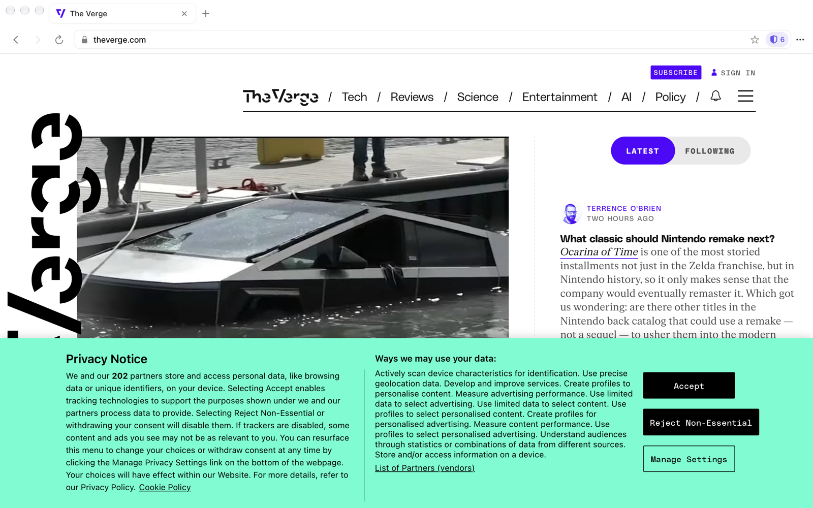
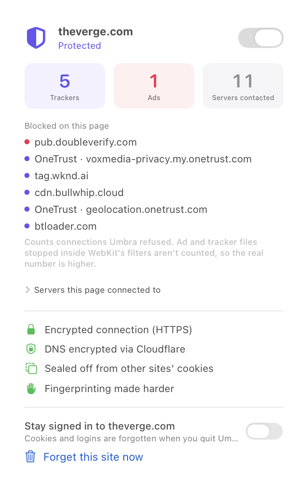
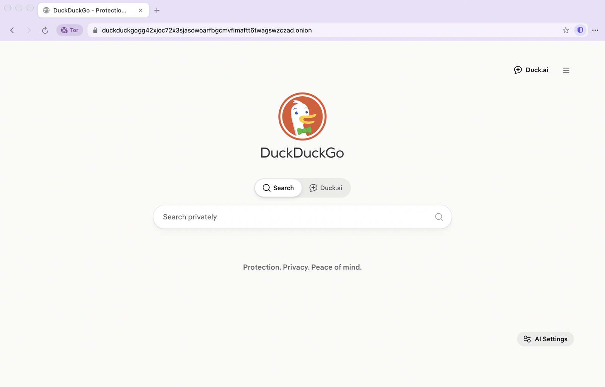
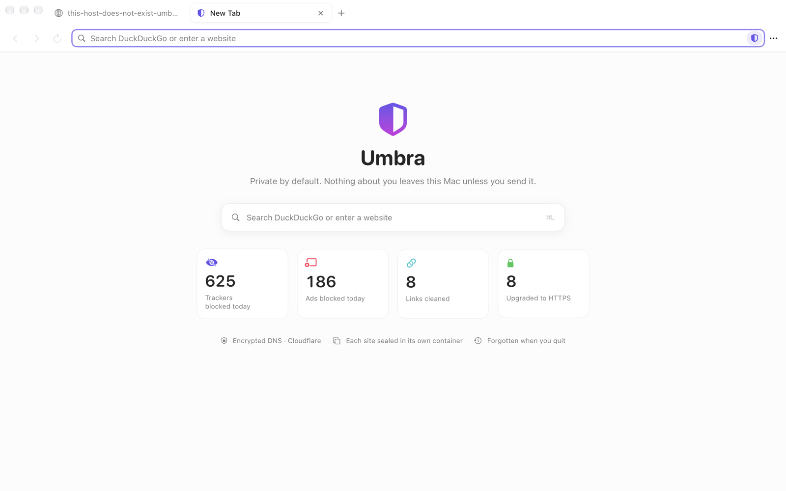

<div align="center">


# Umbra

**A fast, native Mac browser that's private by default: every site sealed in its own box,
trackers blocked and counted, DNS encrypted, Tor one shortcut away, nothing sent home.**


</div>

<p align="center"></p>

## What it does for you

| Protection | What it means |
|---|---|
| **Each site in its own container** | Every site gets a separate cookie jar and storage, so ad networks can't recognise you from one site to the next. |
| **Forgotten when you quit** | Cookies, logins and cache vanish when Umbra quits, except for sites you mark "Stay signed in". |
| **Trackers and ads blocked** | EasyPrivacy and EasyList (about 93,600 domains plus 16,400 patterns), with empty ad spaces hidden. |
| **Every block counted** | The shield badge and panel show which trackers each page tried to load, and who owns them. |
| **Encrypted DNS** | Your ISP and Wi-Fi owner can't see which sites you look up. The fastest of Quad9, Cloudflare or Mullvad is picked automatically. |
| **HTTPS-only** | Always tries the encrypted version first, and warns before going without it. |
| **Clean links** | Removes `utm_`, `fbclid`, `gclid` and dozens more, and skips redirect wrappers. |
| **Anti-fingerprinting** | Canvas and audio readings get per-site noise, the CPU count is generalised, and the user agent matches Safari's. |
| **No WebRTC IP leaks** | Pages can't discover your real IP address. |
| **Global Privacy Control** | Tells sites you don't consent to your data being sold. |
| **Tor windows** | ⇧⌘N opens a window that goes through the Tor network: sites don't see your IP address and your network operator can't see which sites you visit. |
| **Zero telemetry** | No analytics, crash reports, update checks or search suggestions. Umbra never phones home. |

<p align="center"></p>

## Tor windows

Open one with **File → New Tor Window** (⇧⌘N). Everything in it goes through the
[Tor network](https://www.torproject.org), using the official Tor program bundled inside Umbra.

<p align="center"></p>

| Who | Normal window | Tor window |
|---|---|---|
| **Your network operator** (ISP, mobile carrier, Wi-Fi owner) | sees which sites you visit, not what you do there | sees only that you use Tor |
| **The sites you visit** | see your IP address (and so your rough location) | see a Tor exit address, different for every site |
| **Ad and tracker networks** | blocked, and sealed off per site | blocked, and sealed off per site |

- **A separate circuit for every site**, so even the exit addresses can't link your visits.
- **Separate from normal windows:** its own memory-only containers, no history, nothing kept.
- **`.onion` sites** work, and show as secure.
- **New Identity** (⇧⌘U) gives every Tor tab new circuits and empty containers.
- Tor starts on demand. The first connection takes 15–40 s; later ones about 3 s.

Tor windows hide *where you are* and *where you go*. They don't make Umbra identical to every
other Tor user the way Tor Browser does, so for protection against powerful adversaries use
Tor Browser.

## Fast, because it's native

Umbra uses Apple's WebKit, the same engine as Safari, with a native SwiftUI interface, so
it's light on memory and battery. Blocking also means pages download less. Measured against a
plain WebKit view with no protections:

| Site | First visit (Umbra / plain) | Repeat visit (Umbra / plain) | Requests (Umbra / plain) |
|---|---|---|---|
| apple.com | **0.81 s** / 1.34 s | **0.36 s** / 0.55 s | 45 / 46 |
| github.com | **1.66 s** / 1.84 s | 0.91 s / **0.81 s** | 93 / 96 |
| wikipedia.org | 3.79 s / 3.82 s | 3.43 s / 3.42 s | 25 / 25 |
| theverge.com (tracker-heavy) | **2.0–2.4 s** / 3.8–3.9 s | — | **165** / 246 (data: 1.6 MB / 3.1 MB) |

Measured by the built-in self-test (`docs/TESTING.md`) on an M3 MacBook Air: page load, averaged
over alternating runs. "Plain" is a WKWebView with no proxy, rules or scripts. One Mac and one
network, so expect variation, and on pages with no trackers the two are roughly even.

<p align="center"></p>

The speed comes from three things:

- **Blocking:** the browser fetches less, about a third fewer requests on news sites.
- **Encrypted DNS that picks the fastest resolver:** on the test network Cloudflare answered in about 40 ms and Quad9 in about 200 ms.
- **Connections start as soon as an IPv4 address is known.**

## Install

1. Download **Umbra-x.y.z.dmg** from the [latest release](../../releases/latest).
2. Drag **Umbra** to **Applications**.
3. The first time, **right-click Umbra → Open**. It's ad-hoc signed, not notarized.

Requires a Mac with Apple Silicon and macOS 15 or later. To make Umbra your default browser:
**System Settings → Desktop & Dock → Default web browser**.

## Everyday use

| | |
|---|---|
| ⌘T / ⌘W / ⇧⌘T | New tab / close tab / reopen closed tab |
| ⌘N / ⇧⌘N | New window / new Tor window |
| ⇧⌘U | New Tor identity (in a Tor window) |
| ⌘L | Address bar (type a site or a search) |
| ⌘[ / ⌘] | Back / forward |
| ⌘R / ⌘. | Reload / stop |
| ⌘F / ⌘G | Find on page / find next |
| ⌘D | Bookmark |
| ⌘= / ⌘- / ⌘0 | Zoom |
| ⌃Tab / ⌘1…9 | Switch tabs |

**A site doesn't work?** Click the shield in the address bar and turn protections off for
that site. **Want to stay signed in somewhere?** Same panel: *Stay signed in*.

## How it works

Every site gets its own WebKit data store and its own tiny proxy on `127.0.0.1`. The proxy
sees only hostnames, never page content (HTTPS stays end-to-end). It blocks and counts
trackers, resolves names over encrypted DNS, and relays the rest. WebKit's own content
blocker handles path-level rules and hides ad spaces. A small script injected before page
scripts adds Global Privacy Control, WebRTC blocking and fingerprint noise.

Full details, including trade-offs, are in **[docs/ARCHITECTURE.md](docs/ARCHITECTURE.md)**.
How it's tested is in **[docs/TESTING.md](docs/TESTING.md)**.

## Limitations

- **No HTTP/3.** Traffic goes through the local proxy, which carries TCP only.
- **No extensions, password AutoFill or sync.** WebKit doesn't offer them to third-party browsers.
- **The count is a lower bound.** It counts connections the proxy refused; WebKit's filters
  block more that can't be counted.
- **Fingerprinting defenses raise the bar but aren't anonymity.** For protection against
  powerful adversaries, use Tor Browser.
- **Tor windows are slower** than normal browsing, and don't yet support bridges for networks
  that block Tor.

## Build from source

```bash
git clone https://github.com/arun5k1095/Umbra.git && cd Umbra
./build.sh                    # → build/Umbra.app
scripts/make-dmg.sh           # → dist/Umbra-<version>.dmg
scripts/update-filters.sh     # refresh EasyList / EasyPrivacy / Public Suffix List
```

Needs Xcode or the Command Line Tools. There are no third-party code dependencies. The first
build runs `scripts/fetch-tor.sh`, which downloads the official Tor Expert Bundle and checks it
against a pinned SHA-256 (and the Tor Project's GPG signature if gpg is installed).

## License

[MIT](LICENSE). Filter lists: EasyList and EasyPrivacy (GPL-3.0 / CC BY-SA 3.0); site
boundaries: Public Suffix List (MPL-2.0); Tor (BSD-3-Clause, this build GPL-3.0), run as a
separate program. See [NOTICE.md](NOTICE.md). Umbra isn't affiliated with the Tor Project.
